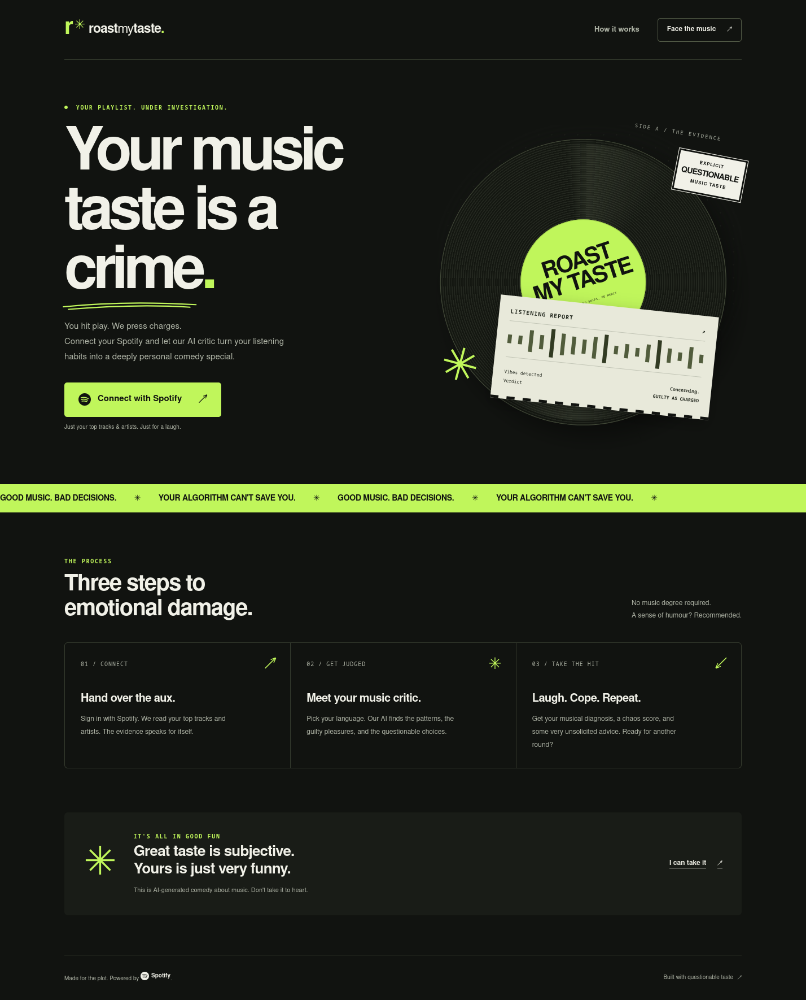
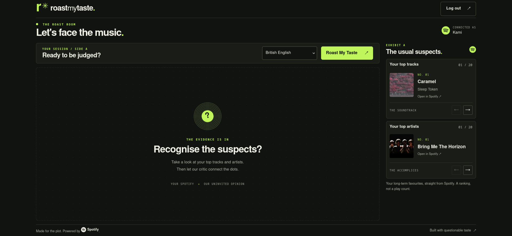
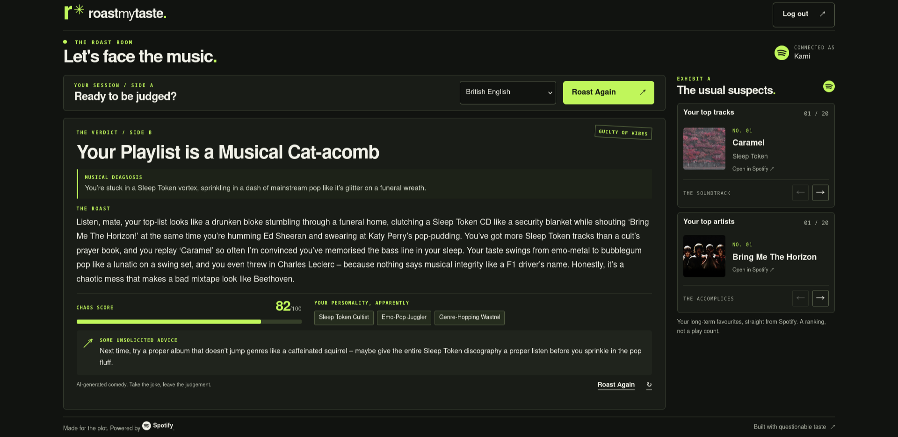
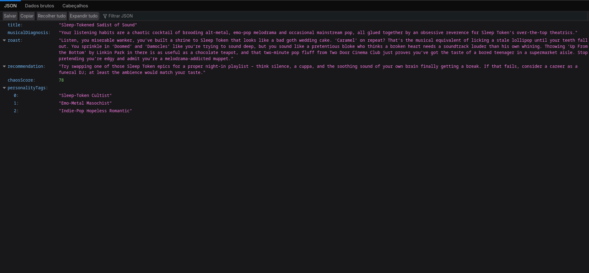

# RoastMyTaste

**Your music taste is a crime.**

Connect Spotify and turn your top tracks and artists into a personalised AI comedy roast. RoastMyTaste now includes a responsive web experience inside the existing Spring Boot process, with a musical diagnosis, unsolicited advice, a chaos score, and personality tags.

[Documentação em português](README_pt.md)

**Home screen**



**After Spotify login**





## Features and architecture

- Spotify OAuth2 Authorization Code Flow; tokens stay on the server.
- Compact, accessible Thymeleaf interface with four languages, top-track/artist carousels, and progressive loading/retry behaviour.
- Spring AI through Groq, with a deterministic fake AI under the preserved `local` profile.
- Existing authenticated REST/debug endpoints and `RoastAnalysis` contract.
- GitHub-native build/test CI without production credentials.

Requires **Java 25**. Stack: Spring Boot **4.0.6**, Spring MVC, Thymeleaf, Spring Security OAuth2 Client, Spring AI **2.0.0-M6**, Groq, Gradle Wrapper **9.4.1**, HTML5, CSS3, and minimal vanilla JavaScript. There is no separate frontend service or Node.js runtime.

```text
Browser → Spring MVC / Thymeleaf → Spring Security OAuth2
                                 ↓
                       AnalyzeMusicTasteUseCase
                                 ↓
                       AnalyzeMusicTasteService
                         ├─ SpotifyProvider → SpotifyProviderAdapter / SpotifyApiClient
                         └─ AiAnalyzisProvider
                              ├─ SpringAiAnalyzerProvider → Groq
                              └─ FakeAiAnalyzerProvider (local)
```

Web controllers in `interfaces/web` and REST controllers in `interfaces/rest` reuse the same application use case. The application service orchestrates Spotify data retrieval and AI analysis; controllers do not duplicate that work. Application ports, AI prompts, personality rules, and the `RoastAnalysis` response contract remain unchanged. Track and artist responses additionally carry an optional `imageUrl` from Spotify; existing fields and constructors are preserved.

## Setup

Install a JDK 25. Use the checked-in Gradle wrapper; a global Gradle installation is unnecessary.

```bash
cp .env.example .env
```

Spring Boot imports `.env` automatically; it is excluded from Git. Environment variables can be used instead.

| Variable | Purpose |
| --- | --- |
| `SPOTIFY_CLIENT_ID` | Spotify application client ID |
| `SPOTIFY_SECRET` | Spotify client secret |
| `SPOTIFY_REDIRECT_URI` | Defaults to `http://127.0.0.1:8080/login/oauth2/code/spotify` |
| `GROQ_API_KEY` | Groq API key; unnecessary in `local` |
| `ROAST_INTENSITY` | `soft`, `mild`, `savage`, `unhinged`; default `unhinged` |
| `SESSION_COOKIE_SECURE` | `false` for local HTTP; set `true` for production HTTPS |

### Spotify OAuth2

1. Create an app in the [Spotify Developer Dashboard](https://developer.spotify.com/dashboard).
2. Register exactly `http://127.0.0.1:8080/login/oauth2/code/spotify` as the development redirect URI.
3. Configure your client ID and secret. The required `user-top-read` scope is already configured.
4. If the Spotify app is in development mode, grant the test account access in Spotify's app settings.

The public interface is available at **http://localhost:8080**. For an end-to-end local login, start at **http://127.0.0.1:8080**: the default callback uses that host, and OAuth state depends on the same browser session cookie. Switching between `localhost` and `127.0.0.1` during login loses that cookie. Spotify requires an explicit loopback address for local HTTP redirects ([documentation](https://developer.spotify.com/documentation/web-api/concepts/redirect_uri)).

Login starts at `/oauth2/authorization/spotify`. Spring handles the authorization code exchange and authorized client, then sends the browser to `/roast`. No separate registration system is used.

### Groq, languages, and intensity

The existing provider configuration uses `https://api.groq.com/openai/v1`, `openai/gpt-oss-120b`, and temperature `0.7`. The base URL is `spring.ai.openai.base-url`; the previously documented `GROQ_URL`/`GROQ_API_URL` variables are not consumed.

| Language | Code |
| --- | --- |
| British English (default) | `en-GB` |
| American English | `en-US` |
| Brazilian Portuguese | `pt-BR` |
| Spanish | `es` |

Language selection continues to use `RoastLanguage.fromCode`. Intensity remains a developer setting: `roast.intensity`, configured through `ROAST_INTENSITY`. There is no user-facing intensity control or new API parameter. The chaos score is a result from 0–100, independent of intensity.

## Run

```bash
./gradlew bootRun
```

Open **http://localhost:8080**, or **http://127.0.0.1:8080** for local Spotify login.

For the deterministic fake AI:

```bash
./gradlew bootRun --args='--spring.profiles.active=local'
# Alternative:
SPRING_PROFILES_ACTIVE=local ./gradlew bootRun
```

The `local` profile preserves `FakeAiAnalyzerProvider` and disables real AI clients, so it does not require a Groq key. Its responses are fixed in all four languages. Landing-page previews can start without Spotify credentials; logging in and fetching listening data still require a valid Spotify setup. Automated tests mock external services and use isolated configuration without reading `.env`.

## Routes and response

| Route | Behaviour |
| --- | --- |
| `GET /` | Public landing page |
| `GET /roast` | Authenticated roast room; defaults to British English |
| `POST /roast` | Generate a roast; requires the session and CSRF token |
| `POST /logout` | End the local session; requires CSRF |
| `GET /oauth2/authorization/spotify` | Start Spotify login |
| `GET /api/v1/analysis?language=en-GB` | Existing authenticated JSON response |
| `GET /api/v1/me` | Existing Spotify profile endpoint |
| `GET /api/v1/debug/top-tracks` | Top tracks |
| `GET /api/v1/debug/top-artists` | Top artists |
| `GET /api/v1/debug/profile` | Constructed `UserProfile` |

The REST API retains the existing OAuth2 session authentication; no new bearer-token authentication scheme is introduced. The browser uses a server-rendered form, enhanced with JavaScript for loading, duplicate-click prevention, retry, and a 95-second timeout. Ordinary form submission also works without JavaScript.

The roast room previews your long-term top tracks and artists through the existing authenticated endpoints, including album covers and artist images from Spotify. Both carousels support animated button and keyboard navigation, keep their position while a roast is generated, and handle empty or unavailable data independently. Missing images use a fallback, and transitions respect reduced-motion preferences. The page has no nested scrolling regions: longer results expand the page naturally, and small screens flow vertically to keep the text readable.

`RoastAnalysis` retains `title`, `musicalDiagnosis`, `roast`, `recommendation`, `chaosScore`, and `personalityTags`. All generated fields are rendered as escaped text.

Unhinged API response example (`ROAST_INTENSITY=unhinged`):



## Security and failures

CSRF stays enabled for generation and logout. Credentials remain server-side; session cookies remain `HttpOnly` and `SameSite=Lax`. Use `SESSION_COOKIE_SECURE=true` with HTTPS. Landing/assets are public; `/roast` and `/api/**` require authentication. Logout clears the local session and does not revoke the Spotify grant.

Friendly views cover insufficient listening history, expired authentication, Spotify outages, AI timeouts/malformed responses, unsupported languages, and unexpected failures. Client requests have timeouts; AI requests do not automatically repeat a generation. Pages include visible focus, keyboard navigation, readable contrast, and reduced-motion support.

## Tests and CI

```bash
./gradlew test
# The standard lifecycle used by CI, including compilation, tests, and packaging:
./gradlew clean build --no-daemon --console=plain
```

The default `contextLoads` integrity test starts the application with `local`. Regression tests cover fake responses in all languages, web rendering, OAuth2, CSRF, safe text rendering, provider failures, application service orchestration, and REST compatibility. No tests require Spotify or Groq production credentials.

[CI](.github/workflows/ci.yml) runs on pushes/PRs to `main` and manual dispatch. Official GitHub/Gradle actions check out the current repository, configure Temurin 25, validate/cache the wrapper, and run `clean build` with tests enabled. Only `contents: read` is granted. There is no publishing, SSH deployment, or production secret requirement.

The previous workflow skipped tests, published to GHCR, and deployed to a Droplet through `appleboy/ssh-action`. No explicit DeepOcean/VCS integration was found in tracked configuration. That deployment path was replaced; external GitHub integrations require separate settings changes if they remain. The investigation and exact manual checks are in [docs/ci-cleanup.md](docs/ci-cleanup.md).

## Why this project exists

A portfolio project demonstrating secure OAuth, external API integration, structured AI responses, and a small, testable architecture through a complete entertainment product.
