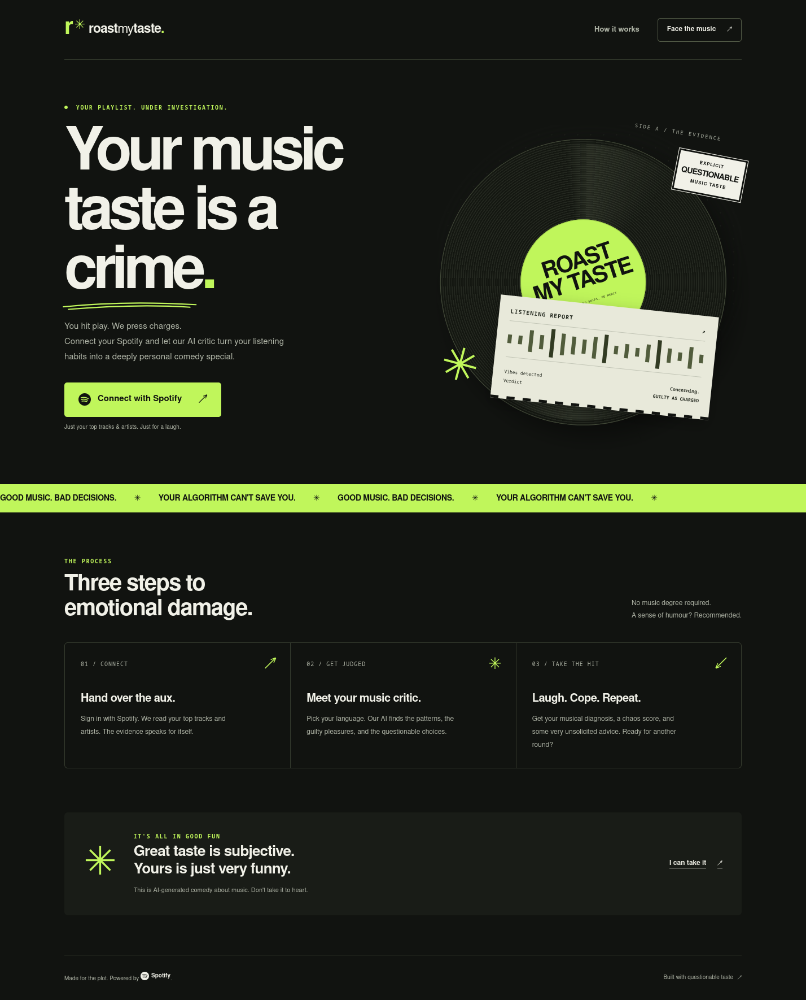
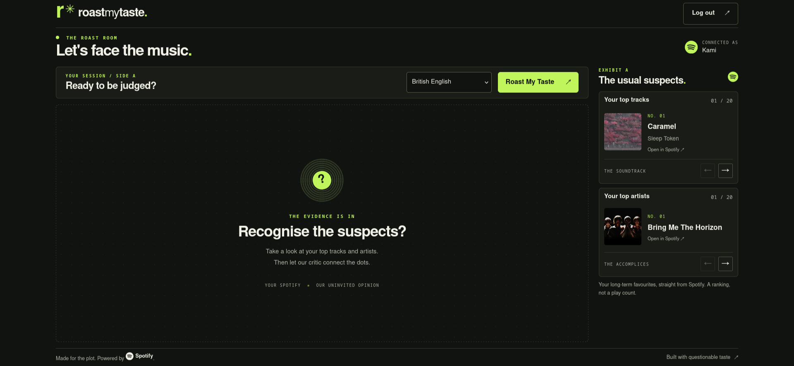
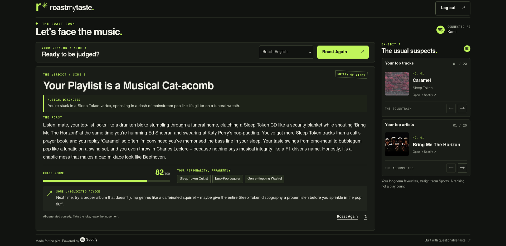
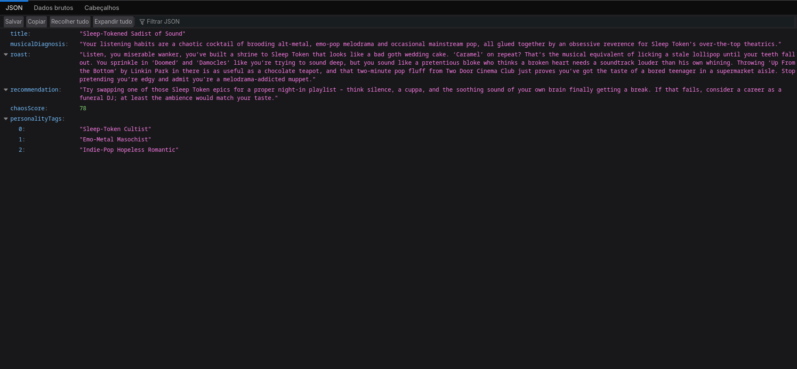

# RoastMyTaste

**Your music taste is a crime.**

O RoastMyTaste conecta sua conta do Spotify e transforma seus top tracks e artistas em um roast personalizado por IA. Uma experiência de entretenimento com diagnóstico musical, recomendação sarcástica, chaos score e tags de personalidade — agora com interface web no próprio Spring Boot.

[English documentation](README.md)

**Tela inicial**



**Após login com Spotify**





## Funcionalidades

- Interface compacta, escura e acessível, com login via Spotify e carrosséis de top tracks e artistas.
- OAuth2 Authorization Code Flow e gerenciamento de tokens no servidor pelo Spring Security.
- Roast estruturado por Spring AI e Groq, com quatro idiomas.
- Perfil `local` com IA determinística para desenvolvimento e testes.
- API REST e endpoints de debug preservados.
- CI nativo do GitHub com compilação e testes sem credenciais de produção.

## Tecnologias e arquitetura

Java **25**, Spring Boot **4.0.6**, Spring MVC, Thymeleaf, Spring Security OAuth2 Client, Spring AI **2.0.0-M6**, Groq e Gradle Wrapper **9.4.1**. HTML5, CSS3 e JavaScript vanilla, sem serviço frontend separado.

```text
Browser → Spring MVC / Thymeleaf → Spring Security OAuth2
                                 ↓
                       AnalyzeMusicTasteUseCase
                                 ↓
                       AnalyzeMusicTasteService
                         ├─ SpotifyProvider → SpotifyProviderAdapter / SpotifyApiClient
                         └─ AiAnalyzisProvider
                              ├─ SpringAiAnalyzerProvider → Groq
                              └─ FakeAiAnalyzerProvider (local)
```

A aplicação mantém a separação entre domínio, portas da aplicação, infraestrutura e interfaces HTTP. Os controllers web em `interfaces/web` e REST em `interfaces/rest` compartilham o mesmo caso de uso. A camada web não duplica chamadas ao Spotify nem a orquestração de IA. Portas, prompts e contrato de `RoastAnalysis` foram preservados. As respostas de tracks e artistas também incluem um `imageUrl` opcional do Spotify, mantendo os campos e construtores existentes.

## Configuração

Instale um JDK 25. O projeto usa o Gradle Wrapper, sem instalação global de Gradle.

```bash
cp .env.example .env
```

Preencha o `.env`, que é ignorado pelo Git e importado automaticamente pelo Spring Boot. Também é possível fornecer as variáveis pelo ambiente.

| Variável | Finalidade |
| --- | --- |
| `SPOTIFY_CLIENT_ID` | Client ID do aplicativo Spotify |
| `SPOTIFY_SECRET` | Client secret do Spotify |
| `SPOTIFY_REDIRECT_URI` | Padrão: `http://127.0.0.1:8080/login/oauth2/code/spotify` |
| `GROQ_API_KEY` | Chave da Groq; dispensável no perfil `local` |
| `ROAST_INTENSITY` | `soft`, `mild`, `savage` ou `unhinged`; padrão `unhinged` |
| `SESSION_COOKIE_SECURE` | `false` em HTTP local; use `true` com HTTPS em produção |

### Spotify OAuth2

1. Crie um aplicativo no [Spotify Developer Dashboard](https://developer.spotify.com/dashboard).
2. Cadastre exatamente `http://127.0.0.1:8080/login/oauth2/code/spotify` como Redirect URI para desenvolvimento.
3. Configure o client ID e secret. O escopo `user-top-read` já está definido.
4. Se o aplicativo estiver em development mode, permita o acesso da conta de teste nas configurações do Spotify.

Abra a interface em **http://localhost:8080**. Para concluir o OAuth local, use **http://127.0.0.1:8080** desde o início: a sessão é vinculada ao host, e o callback padrão usa `127.0.0.1`. Alternar entre `localhost` e `127.0.0.1` durante o login perde o cookie usado para validar o `state`. O Spotify exige um endereço loopback explícito para callbacks HTTP locais ([documentação](https://developer.spotify.com/documentation/web-api/concepts/redirect_uri)).

O botão inicia `GET /oauth2/authorization/spotify`. O Spring troca o código por tokens no servidor e redireciona o usuário para `/roast`. Não há cadastro separado.

### Groq, idiomas e intensidade

O provedor usa a API compatível com OpenAI em `https://api.groq.com/openai/v1`, com `openai/gpt-oss-120b` e temperatura `0.7`, como na configuração existente. A URL é definida por `spring.ai.openai.base-url`; não há variável `GROQ_URL`/`GROQ_API_URL` em uso.

| Idioma | Código |
| --- | --- |
| Inglês britânico (padrão) | `en-GB` |
| Inglês americano | `en-US` |
| Português brasileiro | `pt-BR` |
| Espanhol | `es` |

O parsing continua em `RoastLanguage.fromCode`. A intensidade é uma configuração interna: `roast.intensity`, alimentada por `ROAST_INTENSITY`. Não existe seletor, parâmetro de API ou preferência de usuário para intensidade. O chaos score de 0 a 100 é parte do resultado, independente dessa configuração.

## Executar

```bash
./gradlew bootRun
```

Interface: **http://localhost:8080**. Para o fluxo completo de login local: **http://127.0.0.1:8080**.

Para usar a IA fake:

```bash
./gradlew bootRun --args='--spring.profiles.active=local'
# Alternativa:
SPRING_PROFILES_ACTIVE=local ./gradlew bootRun
```

O perfil `local` mantém `FakeAiAnalyzerProvider`, com respostas fixas nos quatro idiomas, e desativa os clientes de IA reais. Não exige uma chave Groq. Sem credenciais Spotify, a landing page pode ser aberta, mas o login e os dados de escuta continuam dependendo de uma configuração Spotify válida. Os testes automatizados fazem os mocks necessários, sem acessar Spotify/Groq e sem importar o `.env`.

## Interface e API

| Rota | Uso |
| --- | --- |
| `GET /` | Landing page pública |
| `GET /roast` | Interface autenticada; inglês britânico por padrão |
| `POST /roast` | Gera o roast; sessão e CSRF obrigatórios |
| `POST /logout` | Encerra a sessão; CSRF obrigatório |
| `GET /oauth2/authorization/spotify` | Inicia o login |
| `GET /api/v1/analysis?language=en-GB` | Análise JSON autenticada; contrato preservado |
| `GET /api/v1/me` | Perfil Spotify autenticado |
| `GET /api/v1/debug/top-tracks` | Top tracks |
| `GET /api/v1/debug/top-artists` | Top artists |
| `GET /api/v1/debug/profile` | `UserProfile` construído a partir dos dados do Spotify |

Os endpoints REST continuam usando a sessão OAuth2 existente. Não foi adicionado um novo mecanismo de autenticação por bearer token. A geração na interface funciona como formulário no servidor e recebe melhoria progressiva com JavaScript para loading, prevenção de cliques duplicados, retry e timeout de 95 segundos. Sem JavaScript, o formulário continua funcionando.

A tela de roast apresenta top tracks e artistas de longo prazo pelos endpoints autenticados existentes, incluindo capas de álbuns e imagens de artistas do Spotify. Os carrosséis têm transições ao navegar por botões ou teclado, mantêm a posição durante a geração e tratam listas vazias ou falhas de forma independente. Imagens ausentes usam um fallback, e as transições respeitam a preferência por movimento reduzido. A página não tem regiões internas de rolagem: resultados longos expandem a página naturalmente. Em telas pequenas, o conteúdo flui verticalmente para preservar a leitura.

O record `RoastAnalysis` mantém `title`, `musicalDiagnosis`, `roast`, `recommendation`, `chaosScore` e `personalityTags`. A interface renderiza texto escapado, nunca HTML confiável produzido pelo modelo.

Exemplo de resposta da API no modo unhinged (`ROAST_INTENSITY=unhinged`):



## Segurança e erros

CSRF permanece ativo para formulários de geração e logout. Tokens e segredos ficam no servidor. Cookies de sessão continuam `HttpOnly` e `SameSite=Lax`; habilite `Secure` em HTTPS. Assets e landing são públicos; `/roast` e `/api/**` exigem autenticação. O logout invalida a sessão local; não revoga a autorização no Spotify.

A interface trata falta de histórico, expiração da sessão, erros do Spotify/Groq, saída inválida da IA, idioma não suportado e falhas inesperadas sem expor detalhes internos. Clientes HTTP têm timeout, e a chamada de IA não repete automaticamente uma geração. A página respeita `prefers-reduced-motion`, tem foco visível e navegação por teclado.

## Testes e CI

```bash
./gradlew test
# Mesmo ciclo padrão usado no CI, incluindo compilação, testes e pacote:
./gradlew clean build --no-daemon --console=plain
```

O teste padrão `contextLoads` verifica a integridade do contexto com o perfil `local`. A suíte também cobre os idiomas do fake provider, controllers web, OAuth2, CSRF, escape de conteúdo, falhas dos provedores, serviço de aplicação e preservação da resposta REST. Serviços externos são mockados.

O workflow [CI](.github/workflows/ci.yml) roda em pushes para `main`, pull requests para `main` e execução manual. Usa checkout do próprio repositório, Temurin 25 e a action oficial do Gradle com validação do wrapper/cache. Executa `clean build` sem pular testes e usa apenas `contents: read`. Não publica imagens, não faz deploy e não depende de secrets.

O workflow anterior publicava no GHCR, pulava testes e acessava um Droplet por SSH (`appleboy/ssh-action`). Não havia referência explícita a DeepOcean/VCS nos arquivos versionados. Esse fluxo foi substituído. Integrações externas do GitHub não são removidas por alterações no código: veja a investigação e as ações manuais em [docs/ci-cleanup.md](docs/ci-cleanup.md).

## Por que este projeto existe

Demonstrar OAuth seguro, consumo de APIs externas, IA com resposta estruturada e uma arquitetura pequena e testável em um produto de entretenimento. O objetivo continua sendo um projeto de portfólio com responsabilidades claras e sem camadas desnecessárias.
